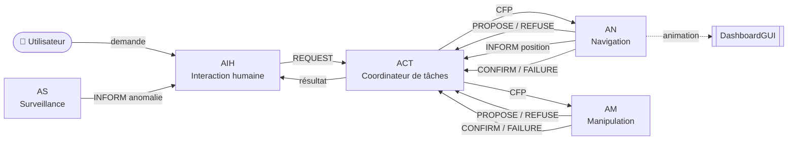
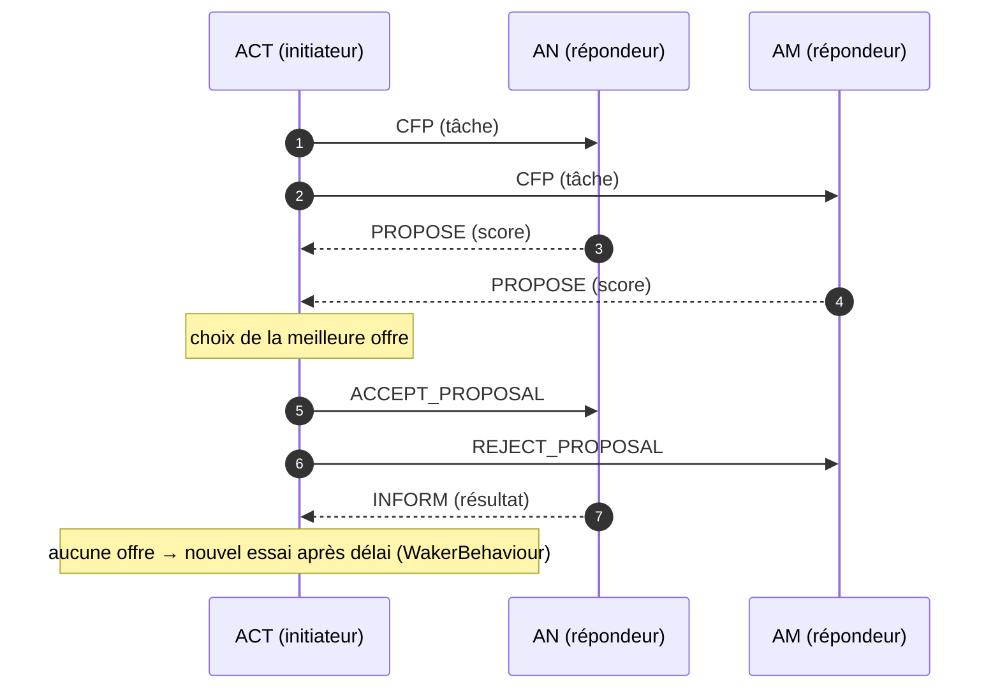

<div align="center">

# 🤖 SMA RoboCup@Home — JADE

**Robot assistant domestique intelligent piloté par un système multi-agents (JADE / FIPA-ACL)**


*Projet universitaire de Master AI & Data Science — module Systèmes Multi-Agents*

</div>

---

## Sommaire

- [Présentation](#présentation)
- [Agents du système](#agents-du-système)
- [Architecture et communication](#architecture-et-communication)
- [Protocole Contract-Net](#protocole-contract-net)
- [Installation et lancement](#installation-et-lancement)
- [Concepts JADE utilisés](#concepts-jade-utilisés)
- [Scénarios de test](#scénarios-de-test)
- [Supervision avec les outils JADE](#supervision-avec-les-outils-jade)
- [Structure du projet](#structure-du-projet)
- [Auteur](#-auteur)

## Présentation

Ce projet simule un **robot de service domestique** du type RoboCup@Home : il reçoit des
demandes d'un humain (aller chercher un objet, se rendre dans une pièce, réagir à une chute…),
répartit le travail entre ses modules spécialisés et surveille la maison en continu.

Chaque module du robot est un **agent autonome** de la plateforme
[JADE](https://jade.tilab.com), conforme au standard **FIPA**. Les agents ne s'appellent pas
directement : ils négocient par **messages ACL**, et l'attribution des tâches se fait par le
protocole **Contract-Net** (appel d'offres, propositions chiffrées, choix du meilleur agent).

La conception suit les méthodologies **GAIA** (rôles, interactions) et **MaSE** (objectifs,
conversations).

## Agents du système

| Agent | Sigle | Rôle | Comportements JADE |
|---|---|---|---|
| `HumanInteractionAgent` | **AIH** | Reçoit les demandes de l'utilisateur et lui rend compte | `CyclicBehaviour` |
| `TaskCoordinatorAgent` | **ACT** | Priorise les tâches et lance les appels d'offres | `ContractNetInitiator`, `WakerBehaviour` (réessai) |
| `NavigationAgent` | **AN** | Déplace le robot entre les pièces, publie sa position | `ContractNetResponder`, `OneShotBehaviour` |
| `ManipulationAgent` | **AM** | Saisit et dépose les objets, gère une file d'attente | `ContractNetResponder`, `CyclicBehaviour` |
| `SurveillanceAgent` | **AS** | Scrute la maison toutes les 10 s et signale les anomalies | `TickerBehaviour` |

La priorité d'une tâche est un **score pondéré** calculé par
`PriorityCalculator` ; un tableau de bord Swing (`DashboardGUI`) affiche en temps réel la
position du robot, la file des tâches et les alertes.

## Architecture et communication



| Performatif FIPA | Émetteur → Destinataire | Signification |
|---|---|---|
| `REQUEST` | AIH → ACT | Nouvelle tâche |
| `CFP` | ACT → AN, AM | Appel d'offres |
| `PROPOSE` / `REFUSE` | AN, AM → ACT | Offre chiffrée ou incompatibilité |
| `ACCEPT_PROPOSAL` / `REJECT_PROPOSAL` | ACT → AN, AM | Choix du gagnant |
| `CONFIRM` / `FAILURE` | AN, AM → ACT → AIH | Succès ou échec |
| `INFORM` | AS → AIH, AN → ACT | Anomalie détectée, position du robot |

## Protocole Contract-Net



## Installation et lancement

**Prérequis** : Java 11 ou plus récent (JDK) et [Apache Ant](https://ant.apache.org/).

```bash
git clone https://github.com/Minyurano/sma-robocup-athome-jade.git
cd sma-robocup-athome-jade

ant run            # télécharge JADE dans lib/ si besoin, compile et lance le système
ant run-jade-gui   # lance les agents avec l'interface JADE (RMA, Sniffer, DF Browser)
ant jar            # construit sma_robocup.jar
ant clean          # supprime out/, le JAR et les fichiers générés par JADE
ant -p             # liste toutes les commandes
```

JADE est téléchargé automatiquement au premier lancement (`ant get-jade`). Sans connexion,
téléchargez `jade.jar` sur [jade.tilab.com](https://jade.tilab.com/download/jade/) et placez-le
dans `lib/jade.jar`.

<details>
<summary>Sans Ant (compilation manuelle)</summary>

```bash
mkdir out
javac -cp lib/jade.jar -d out -encoding UTF-8 $(find src -name "*.java")

java -cp "lib/jade.jar:out" robocup.Main      # Linux / macOS
java -cp "lib/jade.jar;out" robocup.Main      # Windows
```
</details>

## Concepts JADE utilisés

| Behaviour | Utilisé par | Rôle |
|---|---|---|
| `CyclicBehaviour` | AIH, ACT, AM | Écoute permanente des messages |
| `OneShotBehaviour` | AN, AM | Exécution unique (déplacement, saisie) |
| `TickerBehaviour` | AS | Surveillance périodique (toutes les 10 s) |
| `WakerBehaviour` | ACT | Nouvel appel d'offres après un délai |
| `ContractNetInitiator` | ACT | Lance le protocole Contract-Net |
| `ContractNetResponder` | AN, AM | Répond aux appels d'offres |

Les agents publient leurs services dans le **Directory Facilitator (DF)** : le coordinateur
découvre ainsi dynamiquement qui sait naviguer ou manipuler, sans adresse codée en dur.

## Scénarios de test

Les tâches s'ajoutent depuis le tableau de bord ou dans `Main.java` :

```java
// Urgence soumise au démarrage : priorité maximale
Task urgence = new Task("urgence", "Chute détectée", "salle_de_bain", 10);
// récupérer l'AIH via AgentController puis appeler soumettreTache(urgence)
```

| Scénario | Comportement attendu |
|---|---|
| Aller chercher un objet dans la cuisine | AN et AM répondent au CFP ; le meilleur score gagne |
| Deux tâches simultanées | La plus prioritaire passe d'abord ; l'autre attend dans la file de AM |
| Aucun agent disponible | ACT relance l'appel d'offres après délai |
| Chute détectée par AS | Alerte immédiate transmise à l'AIH |

## Supervision avec les outils JADE

Avec `ant run-jade-gui` :

- **RMA** : liste des 5 agents et de leur état ;
- **Sniffer** : capture en temps réel des messages ACL échangés ;
- **DF Browser** : services enregistrés par chaque agent ;
- **Introspector** : behaviours actifs de chaque agent.

## Structure du projet

```
├── src/robocup/
│   ├── agents/       # AIH, ACT, AN, AM, AS
│   ├── behaviours/   # TaskExecutionBehaviour, SurveillanceBehaviour
│   ├── models/       # Task, TaskStatus, Room
│   ├── gui/          # DashboardGUI (Swing, thème sombre)
│   ├── utils/        # Config, PriorityCalculator
│   └── Main.java     # point d'entrée
├── lib/              # jade.jar (téléchargé automatiquement, non versionné)
└── build.xml         # script Apache Ant
```

> **État du dépôt** : le dossier `src/` sera publié dans une prochaine mise à jour.
> `ant run` l'indique clairement tant qu'il est absent.

## 👤 Auteur

**MINYURANO Aloys** — Master AI & Data Science  
GitHub : [@Minyurano](https://github.com/Minyurano)

Projet universitaire — module Systèmes Multi-Agents  
Plateforme : [JADE 4.x](https://jade.tilab.com)
